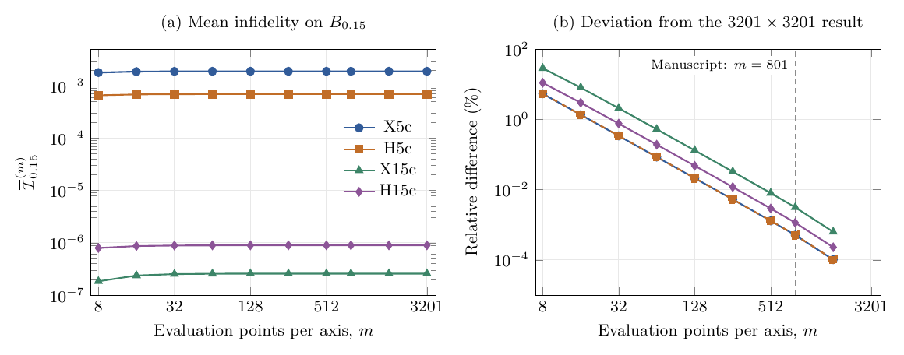

# Evaluation-grid convergence

The mean gate infidelity on B0.15 is evaluated for four fixed controls: X5c, H5c, X15c, and H15c. Only the evaluation-grid resolution changes; the full-precision pulse coefficients remain fixed.



[Vector PDF](evaluation_grid_convergence.pdf) | [Editable TeX](evaluation_grid_convergence.tex) | [Numerical data](evaluation_grid_convergence.csv) | [Verification results](checks.json)

## Model and averaging

The domain is `abs(epsilon), abs(delta_c) <= 0.15`, with common peak nominal drive and `delta_c = Delta/Omega_max`, as in the manuscript tables. Stored controls use `delta = Delta/Omega_0`, so each sequence is evaluated at `delta = max(a_k)*delta_c`. The calculation uses the repository's rectangular-pulse model and average gate infidelity. Ideal virtual Z rotations complete the Hadamard gate.

The mean is the equal-weight average over m x m cell midpoints, for m = 8, 16, 32, 64, 128, 256, 512, 801, 1601, and 3201. The finest grid is a numerical reference, not an exact continuum integral. No optimization, noise averaging, or Sobol sampling enters this calculation.

## Results

| Control | Mean, m=801 | Mean, m=3201 | Absolute relative difference (%) |
|---|---:|---:|---:|
| X5c | 1.890409677021e-3 | 1.890419314165e-3 | 0.00050979 |
| H5c | 6.929533326249e-4 | 6.929568878243e-4 | 0.00051305 |
| X15c | 2.570670543026e-7 | 2.570751442502e-7 | 0.00314692 |
| H15c | 8.919709355986e-7 | 8.919811658927e-7 | 0.00114692 |

The m=801 means reproduce the supplied publication values. Their differences from m=3201 are below 0.0032% for all four controls. Coarse grids can underestimate the means, particularly for X15c; the finer-grid agreement supports the resolution used in the tables. This check concerns the domain mean, not a continuum maximum or the sensitivity of optimized coefficients to a search grid.

The plot shows (a) the four means and (b) their absolute percentage differences from the m=3201 reference. The zero difference at m=3201 is omitted from the logarithmic second panel. `checks.json` records the protocol, input hash, publication-value comparisons, and direct matrix-exponential checks.

## Reproduction

From the repository root:

```sh
python reproduce.py grid-convergence
```

This recalculates all four series from `data/controls.json` using `src/rectangular.py`, checks agreement with the publication and supplied fine-grid results, and draws PNG and SVG figures. Outputs go to `outputs/grid_convergence/`; supplied data remain unchanged. The static requirements are sufficient.

The supplied vector PDF is compiled from the editable TeX and CSV files. To rebuild it from the recalculated data, with a TeX installation providing standalone and PGFPlots:

```sh
cd outputs/grid_convergence
pdflatex -interaction=nonstopmode -halt-on-error evaluation_grid_convergence.tex
```

To draw the figure from already calculated data without repeating the propagation:

```sh
python studies/grid_convergence/plot_grid_convergence.py --input outputs/grid_convergence
```

Sobol checks used in control design are specified in [the design methods](../../design/METHODS.md). They are separate from this fixed-control quadrature check.
